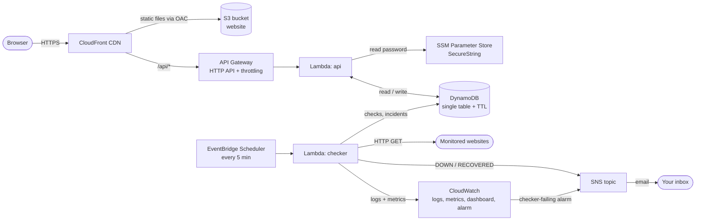

# CloudPulse

**Serverless uptime and latency monitoring on AWS, built to run at zero cost.**

CloudPulse checks your websites every 5 minutes, records how fast they answer, opens an incident
when a site fails twice in a row, and emails you when it goes down and when it recovers. It has a
public status page with 90-day uptime bars and a password-protected admin dashboard.

There are no servers: every part is a managed AWS service, defined in one infrastructure-as-code
template (`template.yaml`), and everything fits inside the AWS free tier.

---

## Contents

1. [Architecture](#architecture)
2. [AWS services and cost](#aws-services-and-cost)
3. [Project structure](#project-structure)
4. [Run it locally (no AWS needed)](#run-it-locally-no-aws-needed)
5. [Deploy to AWS](#deploy-to-aws)
6. [Demo script](#demo-script)
7. [Explaining each cloud concept](#explaining-each-cloud-concept)
8. [Viva questions and answers](#viva-questions-and-answers)
9. [Troubleshooting](#troubleshooting)
10. [Limitations and what I'd do next](#limitations-and-what-id-do-next)

---

## Architecture



**Two paths through the system:**

- **Request path (someone opens the site).** CloudFront serves the React app from a private S3
  bucket. API calls (`/api/*`) go through CloudFront to API Gateway, which invokes the `api`
  Lambda, which reads and writes DynamoDB. The public `/api/status` response is cached at the
  CloudFront edge for 60 seconds.
- **Scheduled path (every 5 minutes).** EventBridge Scheduler invokes the `checker` Lambda. It
  fetches every monitored URL in parallel, stores the results, opens or closes incidents, sends SNS
  emails, and publishes CloudWatch metrics.

The site also has an interactive version of this diagram at `/#/architecture`.

## AWS services and cost

The design target was **$0.00**. Every service below either sits inside AWS's *Always Free* tier
or costs fractions of a cent, and on a new AWS account's **Free plan** AWS cannot charge you at all.

| Service | What it does here | Free allowance (monthly) | CloudPulse usage |
|---|---|---|---|
| **Lambda** | Runs the API and the checker | 1M requests + 400,000 GB-s, always free | ~9,000 checker runs + your clicks |
| **EventBridge Scheduler** | Runs the checker every 5 min | 14M invocations, always free | ~8,640 |
| **DynamoDB** | Stores monitors, checks, rollups, incidents | 25 GB + 25 RCU + 25 WCU provisioned, always free | 10 RCU + 10 WCU, a few MB |
| **SNS** | Emails alerts | 1,000 emails, always free | a handful |
| **CloudFront** | CDN + HTTPS for site and API | 1 TB + 10M requests, always free | tiny |
| **CloudWatch** | Logs, 3 custom metrics, 1 alarm, 1 dashboard | 5 GB logs, 10 metrics, 10 alarms, 3 dashboards, always free | well inside |
| **SSM Parameter Store** | Encrypted admin password | Standard parameters are free | 1 parameter |
| **API Gateway (HTTP API)** | API front door + rate limiting | ~$1 per *million* requests | a few thousand requests, under 1 cent |
| **S3** | Holds the ~700 KB website | ~$0.023 per GB-month | under 1 cent |
| **CloudFormation / SAM** | Creates everything from `template.yaml` | Free | — |

**Avoided on purpose, because they cost money:** NAT Gateway, EC2, RDS, ElastiCache, Secrets
Manager ($0.40 per secret), customer-managed KMS keys, AWS WAF, DynamoDB auto scaling (it creates
CloudWatch alarms).

**Built-in cost guardrails:** at most 10 monitors (`backend/lib/config.ts`), API throttling
(10 req/s), 7-day log retention, DynamoDB TTL that deletes old checks for free, and
`npm run destroy` to remove everything in one command.

## Project structure

```
cloudpulse/
├── template.yaml                 AWS SAM template: every AWS resource (infrastructure as code)
├── backend/
│   ├── handlers/
│   │   ├── api.ts                Lambda #1: the HTTP API (switches on event.routeKey)
│   │   └── checker.ts            Lambda #2: runs every 5 min via EventBridge Scheduler
│   ├── lib/
│   │   ├── config.ts             Environment variables + cost guardrails (limits)
│   │   ├── db.ts                 All DynamoDB access (single-table design, conditional writes)
│   │   ├── run-checks.ts         Checks every monitor, saves results, opens/closes incidents
│   │   ├── http-check.ts         One HTTP check: fetch with 10 s timeout, latency, error text
│   │   ├── incidents.ts          Pure "open / resolve / nothing" decision (2 failures = incident)
│   │   ├── stats.ts              Pure math: uptime %, average, p95, sparkline, 90-day bars
│   │   ├── auth.ts               Admin password from SSM, signed session tokens
│   │   ├── alerts.ts             Sends alert emails through SNS
│   │   ├── metrics.ts            Custom CloudWatch metrics via Embedded Metric Format logs
│   │   └── responses.ts          JSON response helpers (Cache-Control headers)
│   └── test/                     Vitest unit tests + an integration test against in-memory DynamoDB
├── shared/
│   ├── types.ts                  Data types shared by backend and frontend
│   └── format.ts                 Duration / uptime / latency formatting
├── web/                          React frontend (Vite + Tailwind + Recharts)
│   ├── index.html                HTML shell (applies saved light/dark theme early)
│   └── src/
│       ├── main.tsx              Entry point; HashRouter (so S3 only ever serves index.html)
│       ├── App.tsx               Navigation, routes, login guard, footer
│       ├── index.css             Colour tokens for light and dark mode
│       ├── lib/api.ts            fetch wrapper, session token, useApi() hook
│       ├── lib/time.ts           Date/time formatting
│       ├── lib/theme.ts          Light / dark / system theme switch
│       ├── lib/useNow.ts         Current time as React state
│       ├── components/           StatusBadge, StatTile, UptimeBars, Sparkline, LatencyChart, ArchitectureDiagram
│       └── pages/                Home, Status, Login, Dashboard, Monitor detail, Architecture
├── scripts/
│   ├── local-server.ts           Runs the real Lambda code locally on an in-memory DynamoDB
│   ├── seed.ts                   Demo data: 4 monitors, 48h of checks, 90 days of history, 1 incident
│   ├── deploy.sh                 Build + sam deploy + upload website + clear CDN cache
│   ├── destroy.sh                Deletes the whole stack
│   └── dynalite.d.ts             Type declarations for the local DynamoDB clone
├── .github/workflows/ci.yml      CI: lint, type-check, tests, build, template validation
└── package.json                  npm scripts and dependencies
```

### DynamoDB data model (single table)

| Item | Partition key (PK) | Sort key (SK) | Notes |
|---|---|---|---|
| Monitor | `MONITOR` | `<monitorId>` | Holds current status and precomputed 24h stats |
| Check | `CHECK#<monitorId>` | `<ISO timestamp>` | One per check; deleted by TTL after 90 days |
| Daily rollup | `DAY#<monitorId>` | `YYYY-MM-DD` | Atomic counters for the 90-day bars |
| Incident | `INCIDENT#<monitorId>` | `<ISO start time>` | `resolvedAt` added on recovery |

Because ISO timestamps sort alphabetically in time order, "all checks of monitor X since
yesterday" is a single `Query` with `SK >= <yesterday>`. Nothing in the app ever scans the table.

## Run it locally (no AWS needed)

The local server runs the **real** Lambda handler code against **dynalite**, an in-memory clone of
DynamoDB, so you can develop and even demo fully offline.

On CachyOS:

```bash
sudo pacman -S --needed nodejs npm git
```

Then, in the project folder:

```bash
npm install
```

```bash
npm run dev
```

Open http://localhost:5173. The admin password is `admin` locally. Alerts are printed in the
terminal instead of emailed, and the checker runs every 5 minutes as in AWS.

Other useful commands:

```bash
npm test
```

```bash
npm run lint && npm run typecheck && npm run build
```

## Deploy to AWS

Do this from your CachyOS laptop. It takes about 20 minutes the first time, most of it waiting for CloudFront.

### 1. Create the AWS account on the Free plan

Sign up at https://aws.amazon.com/free. When asked, choose the **Free plan** (not Paid). On the
Free plan AWS states that you incur no charges: you get $100+ of credits, and the account simply
closes after 6 months or when the credits run out, unless you choose to upgrade. Turn on MFA for
the root user (IAM console → Security recommendations).

### 2. Add a zero-spend budget alert (belt and braces)

Billing and Cost Management → **Budgets** → Create budget → **Use a template** → **Zero spend
budget** → enter your email → Create. AWS emails you if anything ever costs even $0.01.

### 3. Install the tools

```bash
sudo pacman -S --needed nodejs npm git aws-cli-v2 unzip
```

AWS SAM CLI (official Linux installer):

```bash
cd /tmp && curl -LO https://github.com/aws/aws-sam-cli/releases/latest/download/aws-sam-cli-linux-x86_64.zip
```

```bash
unzip -o /tmp/aws-sam-cli-linux-x86_64.zip -d /tmp/sam-installation && sudo /tmp/sam-installation/install
```

Check everything works:

```bash
node --version && aws --version && sam --version
```

### 4. Log the AWS CLI in

```bash
aws login --region us-east-1
```

A browser window opens. Sign in to the AWS console, and the CLI gets short-lived credentials (needs
AWS CLI 2.32 or newer). Then check it:

```bash
aws sts get-caller-identity
```

> Best practice is to sign in as an IAM user with `AdministratorAccess` rather than the root
> user. For a personal lab account, root with MFA is acceptable. If `aws login` isn't available,
> create an access key for an IAM user and run `aws configure` instead.

```bash
aws configure set region us-east-1
```

### 5. Store the admin password in SSM Parameter Store

`read -s` keeps the password out of your shell history:

```bash
read -rsp 'Choose an admin password: ' PW && echo && aws ssm put-parameter --name /cloudpulse/admin-password --type SecureString --value "$PW" --region us-east-1 && unset PW
```

### 6. Deploy

In the project folder:

```bash
npm ci
```

```bash
npm run deploy
```

The first run asks some questions (`sam deploy --guided`). Answer like this:

| Question | Answer |
|---|---|
| Stack Name `[cloudpulse]` | Enter |
| AWS Region `[us-east-1]` | Enter |
| Parameter AlertEmail | **your email address** |
| Parameter AdminPasswordParameter / CheckSchedule / ScheduleState | Enter (keep defaults) |
| Confirm changes before deploy | `y` |
| Allow SAM CLI IAM role creation | `Y` |
| Disable rollback | `N` |
| *ApiFunction has no authentication. Is this okay?* | `y` every time it's asked (the app checks the admin token itself) |
| Save arguments to configuration file | `Y`, then Enter twice |
| Deploy this changeset? | `y` |

CloudFormation then creates around 30 resources. CloudFront takes 3–10 minutes. At the end, the script
uploads the website and prints the URL (`https://xxxx.cloudfront.net`).

Afterwards, `npm run deploy` redeploys any code change without questions.

### 7. Confirm the alert email

AWS sends **"AWS Notification - Subscription Confirmation"** to the email you entered. Click
**Confirm subscription**. Without this, SNS can't email you. Check spam if it isn't there.

### 8. Load demo data

```bash
npm run seed
```

This adds 4 monitors, 48 hours of check history, 90 days of daily uptime, and one past incident. If
it reports a credentials error, run `eval "$(aws configure export-credentials --format env)"` and
try again.

### 9. Open the site

Open the URL from step 6 and log in at `/#/login` with your password from step 5. Within 5 minutes,
the first real scheduled check runs.

Useful commands while it runs:

```bash
aws logs tail /cloudpulse/cloudpulse/checker --follow --region us-east-1
```

```bash
aws cloudformation describe-stacks --stack-name cloudpulse --query "Stacks[0].Outputs" --output table --region us-east-1
```

### 10. When the lab is over

```bash
npm run destroy
```

This deletes every resource. Delete it before the Free plan's 6 months are up if you don't
want the account to close with data in it. To only *pause* the checks (keeping everything):

```bash
sam deploy --parameter-overrides AlertEmail=you@example.com ScheduleState=DISABLED
```

### Optional: put the code on GitHub (for CI)

Create an empty repository on GitHub, then from the project folder:

```bash
git remote add origin https://github.com/<you>/cloudpulse.git && git push -u origin main
```

The **Actions** tab will show the CI workflow running lint, type-check, tests, build and template
validation on every push.

## Demo script

Prepare beforehand: deployed, seeded, alert email confirmed, logged in. Have these tabs open:
the site, your email inbox, and the AWS console (CloudFormation, Lambda, DynamoDB, CloudWatch).
Have a terminal open in the project folder with `BUCKET` set:

```bash
BUCKET=$(aws cloudformation describe-stacks --stack-name cloudpulse --query "Stacks[0].Outputs[?OutputKey=='WebsiteBucketName'].OutputValue" --output text --region us-east-1)
```

| # | Do this | Say this |
|---|---|---|
| 1 | Open **Architecture** | Walk the two paths: request path (CloudFront → API Gateway → Lambda → DynamoDB) and scheduled path (EventBridge → checker → SNS). |
| 2 | Open **Status**, read the footer, click **Refresh** twice | First load says **MISS** (went all the way to Lambda + DynamoDB). Reload says **HIT** with an age: CloudFront answered from the edge cache. That's `s-maxage=60`. |
| 3 | Open **Dashboard** | Uptime, average and p95 latency, sparklines. Stats are precomputed by the checker after each run, so the dashboard is one cheap query. |
| 4 | Click a monitor (e.g. Wikipedia) | 24h latency chart. The gap is yesterday's seeded outage, matching the resolved incident in the timeline. |
| 5 | **Live outage.** Add a monitor: name `Demo site`, URL `<your site URL>/health1.txt`, expected `200`. Click **Run check now** twice. | That file doesn't exist, so the private S3 bucket answers 403. Two failures in a row open an incident, and the **DOWN** email arrives in your inbox through SNS. |
| 6 | **Live recovery.** In the terminal: `echo ok \| aws s3 cp - s3://$BUCKET/health1.txt`. Wait about 15 seconds, then **Run check now**. | The file now exists, so the check gets HTTP 200, the incident closes, and a **RECOVERED** email arrives with the downtime. Show the incident timeline on the monitor page. |
| 7 | Clean up: delete `Demo site` on the dashboard. `aws s3 rm s3://$BUCKET/health1.txt` | (Use `health2.txt` next rehearsal, because CloudFront caches the 200 response.) |
| 8 | Hammer the API: `for i in $(seq 40); do curl -s -o /dev/null -w "%{http_code} " <site URL>/api/monitors & done; wait` | Mostly 401 (no token), then **429**s: API Gateway throttling rejects them before Lambda even runs. |
| 9 | AWS console tour: **CloudFormation** stack → Resources tab | Everything was created from one template. `npm run destroy` removes it all. |
| 10 | **EventBridge Scheduler** → schedule; **Lambda** → checker → Monitor tab | The schedule fires every 5 minutes, and you can see the invocations and their duration. |
| 11 | **DynamoDB** → Explore items | Show `MONITOR`, `CHECK#…`, `DAY#…`, `INCIDENT#…` keys: one table, query by key, TTL attribute. |
| 12 | **CloudWatch** → Dashboards → `cloudpulse-dashboard` | Custom metrics (monitors up/down, latency) plus Lambda, API Gateway and DynamoDB metrics. Alarms → the "checker errors" alarm watches the monitor itself. |
| 13 | **Systems Manager** → Parameter Store; **S3** bucket → Permissions | Password stored as an encrypted SecureString. The bucket blocks all public access, and only CloudFront can read it. |
| 14 | **Billing** → Free plan / credits | $0 spent. Explain the always-free design choices. |
| 15 | GitHub → **Actions** | CI runs lint, type-check, 23 tests, build and template validation on every push. |

If the internet or AWS misbehaves, run `npm run dev` and show the same app locally.

## Explaining each cloud concept

**Serverless computing.** We never rent or manage a server. AWS runs our code (Lambda) only when an
event arrives, scales automatically, and bills per millisecond, which here is free. The
trade-offs are cold starts (the first request after idle is slower) and a maximum run time.
*Files: `backend/handlers/*.ts`, `template.yaml` → `ApiFunction`, `CheckerFunction`.*

**Event-driven and scheduled compute.** Code runs in response to events: an HTTP request (API
Gateway event), or a timer (EventBridge Scheduler fires every 5 minutes). Nothing sits idle
waiting, which is why it costs nothing between runs.
*Files: `template.yaml` → `EveryFiveMinutes` (ScheduleV2), `backend/handlers/checker.ts`.*

**Managed NoSQL database.** DynamoDB is a fully managed key-value database: AWS handles
replication, patching and backups. We design keys around our queries (single-table design), use
provisioned capacity to stay in the free tier, conditional writes to prevent duplicate incidents,
and TTL to delete old data automatically.
*Files: `backend/lib/db.ts`, `template.yaml` → `Table`.*

**CDN and caching.** CloudFront copies content to edge locations near users. Static files are
cached long-term. The public `/api/status` is cached for 60 seconds using
`Cache-Control: s-maxage=60`, so thousands of visitors cost one Lambda call per minute. The
`X-Cache: Hit/Miss` header proves it.
*Files: `template.yaml` → `Distribution`, `backend/handlers/api.ts` → `statusPage()`, `web/src/pages/StatusPage.tsx`.*

**Object storage and static hosting.** S3 stores the built website files. The bucket is private,
and CloudFront signs its requests with Origin Access Control, so the bucket policy allows only
our distribution.
*Files: `template.yaml` → `WebsiteBucket`, `WebsiteOAC`, `WebsiteBucketPolicy`, `scripts/deploy.sh`.*

**API management and rate limiting.** API Gateway is the managed front door: it routes requests to
Lambda and throttles them (10 per second, bursts of 20). Excess requests get HTTP 429 without ever
running our code, which protects both the app and the bill.
*Files: `template.yaml` → `HttpApi`.*

**Infrastructure as code.** `template.yaml` describes every resource. SAM turns it into
CloudFormation, which computes a changeset, creates resources in the right order, rolls back on
failure, and deletes everything on `sam delete`. The infrastructure is versioned in git like code.
*Files: `template.yaml`, `scripts/deploy.sh`, `scripts/destroy.sh`.*

**Identity and access management (least privilege).** Each Lambda gets its own IAM role with only
the permissions it needs: CRUD on *this* table, publish to *this* topic, and (API only) read
*this one* SSM parameter. If the code were compromised, the damage would be limited.
*Files: `template.yaml` → `Policies` on each function.*

**Secrets management.** The admin password is never in code, git, or the template. It's a
SecureString in SSM Parameter Store, encrypted with KMS, and read at runtime by a role allowed to
read only that parameter. Sessions use HMAC-signed tokens, so the password never travels again
after login.
*Files: `backend/lib/auth.ts`, `template.yaml` → `AdminPasswordParameter`.*

**Pub/sub messaging.** SNS decouples "something happened" from "who needs to know". The checker
publishes one message, and SNS delivers it to every subscriber (email today; SMS, Lambda or a
webhook could be added without changing code).
*Files: `backend/lib/alerts.ts`, `template.yaml` → `AlertTopic`.*

**Observability.** Logs: every Lambda writes to CloudWatch Logs (7-day retention). Metrics: custom
metrics via Embedded Metric Format, plus built-in Lambda, API Gateway and DynamoDB metrics on one
dashboard. Alerting: an alarm emails us if the checker itself starts failing.
*Files: `backend/lib/metrics.ts`, `template.yaml` → `Dashboard`, `CheckerErrorsAlarm`.*

**CI/CD.** GitHub Actions runs lint, type-check, unit and integration tests, the build, and
`cfn-lint` on every push, so broken code or an invalid template is caught before deploy.
Deployment is one command (`npm run deploy`).
*Files: `.github/workflows/ci.yml`, `scripts/deploy.sh`.*

**Cost optimisation.** Every service was chosen with the free tier in mind: provisioned DynamoDB
capacity instead of on-demand, HTTP API instead of REST API, Embedded Metric Format instead of
`PutMetricData`, no NAT Gateway (Lambda stays outside a VPC), TTL instead of cleanup jobs, short
log retention, and a monitor cap.
*Files: `template.yaml` header comment, `backend/lib/config.ts` → `limits`.*

## Viva questions and answers

**1. Why serverless instead of an EC2 instance?**
An EC2 instance would run 24/7 even though we only do work for a second every 5 minutes. With Lambda
we pay only for execution time (free here), there's no OS to patch, and scaling is automatic. The
trade-off is less control and cold starts, which don't matter for this workload.

**2. Walk me through what happens every 5 minutes.**
EventBridge Scheduler invokes the checker Lambda. It loads all monitors with one DynamoDB query,
then fetches every URL in parallel (`Promise.allSettled`, 10-second timeout each). For each result it
saves the check, increments the daily rollup counters, and runs the pure `evaluateCheck()` function
to decide whether to open or resolve an incident. If something changed it emails through SNS,
then it recomputes the 24-hour stats and saves them on the monitor. Finally it logs CloudWatch
metrics.

**3. Why DynamoDB and not RDS (SQL)?**
RDS is a server that runs (and bills) 24/7, and Lambda would need a VPC and NAT Gateway, which costs
money. Our access patterns are simple and known in advance ("this monitor's checks since time T"),
which is exactly what a key-value store does well. Single-table design with PK/SK makes every
query a cheap key lookup, with no scans and no joins.

**4. What stops two overlapping checker runs from sending two alerts?**
A DynamoDB *conditional write*: an incident is opened by setting `openIncidentStartedAt` on the
monitor only `if attribute_not_exists(openIncidentStartedAt)`. DynamoDB applies it atomically, so
only one run can win, and the loser skips the alert. There's an integration test that runs two checks
at once to prove it (`backend/test/run-checks.test.ts`).

**5. Why open an incident after two failures, not one?**
To avoid false alarms. A single failure is often a network blip or a slow DNS lookup. Requiring
two consecutive failures (10 minutes apart) means a real outage still alerts quickly, while a blip
doesn't wake anyone up. The threshold is one constant in `incidents.ts`.

**6. How is the admin password protected?**
It's stored in SSM Parameter Store as a SecureString encrypted with KMS, never in code or git. Only
the API Lambda's IAM role may read that one parameter. Login compares passwords in constant time
and returns an HMAC-signed token with an expiry. Tokens can't be forged without the password, and
changing the password invalidates them all.

**7. How do you know the CDN is actually caching?**
CloudFront adds an `X-Cache` header (`Hit from cloudfront` / `Miss from cloudfront`) and an `Age`
header. The status page footer displays them: refresh twice and it changes from MISS to HIT. The
Lambda sends `Cache-Control: public, max-age=0, s-maxage=60`. `s-maxage` applies to shared caches
like CloudFront, while `max-age=0` stops the browser from caching, so each reload really asks
CloudFront.

**8. How does this stay free, and what would cost money at scale?**
Every service is inside the Always Free tier (Lambda, DynamoDB provisioned 10/10 of 25/25, SNS,
EventBridge, CloudFront, CloudWatch limits). API Gateway and S3 cost fractions of a cent. At scale,
API Gateway requests, more DynamoDB capacity, and CloudWatch logs would be the first real costs.
We'd also want AWS WAF for per-IP rate limiting, which isn't free.

**9. What if the checker itself breaks? Who monitors the monitor?**
If the checker can't record results it throws, which counts as a Lambda error. A CloudWatch
alarm on the checker's `Errors` metric emails us through the same SNS topic. The schedule's retry
policy is 0 because the next run is only 5 minutes away.

**10. How would you scale this to 10,000 monitors?**
Fan-out: the scheduled Lambda would put one message per monitor (or batch) on an SQS queue, and
many checker Lambdas would consume it in parallel. DynamoDB would move to on-demand or autoscaled
capacity, and we'd run checkers in several regions so a single region's network problem doesn't
cause false alerts.

**11. How is the infrastructure created and destroyed?**
`sam deploy` turns `template.yaml` into a CloudFormation changeset. CloudFormation creates
resources in dependency order and rolls everything back if any step fails. `sam delete` removes the
whole stack. Because it's code, the same template can recreate an identical environment anywhere.

**12. What is a cold start, and does it matter here?**
The first invocation after a period of inactivity must start a new execution environment and
load our code, adding a few hundred milliseconds. For a scheduled checker it doesn't matter at
all. For the API it occasionally adds a little delay to a dashboard click. Small bundles (esbuild)
and arm64 help.

## Troubleshooting

| Problem | Fix |
|---|---|
| `sam deploy` fails creating the CloudFront distribution: *"Your account must be verified"* | Some brand-new accounts must be verified before using CloudFront. Open a (free) AWS Support case under Account and billing, then `npm run destroy` and deploy again. |
| Deploy script says the admin password parameter is missing | Run step 5 in the **same region** (us-east-1). |
| Site shows an `AccessDenied` XML page | The website wasn't uploaded yet or the distribution is still deploying. Wait a few minutes and run `npm run deploy` again. |
| No alert emails | Confirm the SNS subscription email (step 7) and check spam. |
| `npm run seed` credentials error | `eval "$(aws configure export-credentials --format env)"`, then retry. |
| `aws: error: argument command: Invalid choice: 'login'` | Update the CLI (`sudo pacman -Syu aws-cli-v2`) or use `aws configure` with an access key. |
| Stack stuck in `ROLLBACK_COMPLETE` | `npm run destroy`, fix the cause shown in the CloudFormation Events tab, deploy again. |
| Login says "Wrong password" right after changing it in SSM | The API Lambda caches the password for up to 5 minutes. Wait, then try again. |

## Limitations and what I'd do next

- **Single-region checks.** All checks come from us-east-1. Checking from 2–3 regions and
  alerting only when most agree would remove regional false positives.
- **5-minute resolution.** Short outages between checks can be missed. EventBridge Scheduler can go
  down to 1 minute (still free) at the cost of 5× more writes.
- **Global, not per-IP, rate limiting.** API Gateway throttles all clients together. Per-IP limits
  need AWS WAF, which has a monthly fee.
- **Single admin password.** Amazon Cognito (free for small user counts) would give real user
  accounts, MFA and password reset.
- **Continuous deployment.** CI doesn't deploy. Adding a GitHub OIDC role in IAM would let a
  workflow run `sam deploy` without storing long-lived AWS keys in GitHub.
- **Cold starts** add a few hundred milliseconds to the first API call after idle. That's acceptable
  here, and provisioned concurrency would fix it but costs money.
- **Hash URLs** (`/#/dashboard`). A CloudFront Function could rewrite clean URLs to `index.html`.
