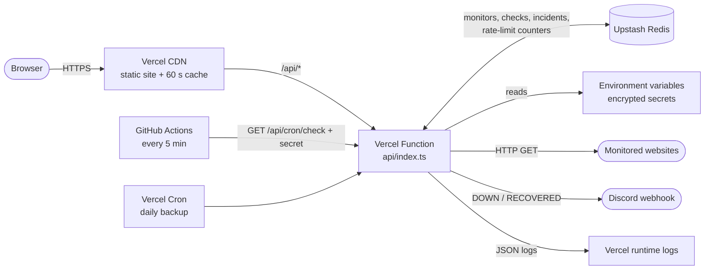

# CloudPulse

**Serverless uptime and latency monitoring on Vercel, built to run at zero cost.**

CloudPulse checks your websites every 5 minutes, records how fast they answer, opens an incident
when a site fails twice in a row, and posts an alert to Discord when it goes down and when it
recovers. It has a public status page with 90-day uptime bars and a password-protected admin
dashboard, including an **outage simulator** for live demos.

There are no servers: the API is one Vercel Function, data lives in Upstash Redis, GitHub Actions
is the scheduler, and everything fits inside free tiers.

> **AWS version:** an AWS-native build of the same app (Lambda, DynamoDB, EventBridge, SNS, S3,
> CloudFront, CloudFormation) lives on the [`aws` branch](https://github.com/murk27/cloudpulse/tree/aws). The table in
> [Same app, two clouds](#same-app-two-clouds) maps each piece across.

---

## Contents

1. [Architecture](#architecture)
2. [Services and cost](#services-and-cost)
3. [Project structure](#project-structure)
4. [Run it locally (no accounts needed)](#run-it-locally-no-accounts-needed)
5. [Deploy to Vercel](#deploy-to-vercel)
6. [Demo script](#demo-script)
7. [Explaining each cloud concept](#explaining-each-cloud-concept)
8. [Same app, two clouds](#same-app-two-clouds)
9. [Viva questions and answers](#viva-questions-and-answers)
10. [Troubleshooting](#troubleshooting)
11. [Limitations and what I'd do next](#limitations-and-what-id-do-next)

---

## Architecture



**Two paths through the system:**

- **Request path (someone opens the site).** Vercel's CDN serves the React app (static files built
  by Vite). Calls to `/api/*` are rewritten to the single Vercel Function, whose router
  (`backend/app.ts`) checks the rate limit and login, then reads or writes Upstash Redis. The public
  `/api/status` response is cached at the edge for 60 seconds.
- **Scheduled path (every 5 minutes).** GitHub Actions calls `GET /api/cron/check` with a secret
  token. The function fetches every monitored URL in parallel, stores the results, opens or closes
  incidents, and posts Discord alerts. A daily Vercel Cron Job calls the same endpoint as a backup.

The site also has an interactive version of this diagram at `/#/architecture`.

## Services and cost

The design target was **$0.00**. Every service is used inside its free tier, and none of them
asks for a credit card.

| Service | What it does here | Free allowance | CloudPulse usage |
|---|---|---|---|
| **Vercel (Hobby)** | CDN, the serverless function, daily cron, Git deployments, logs | 1M function invocations, 4 active-CPU hours / month; personal, non-commercial use | ~9,000 invocations / month |
| **Upstash Redis** | Database + rate-limit counters | 500,000 commands / month, 256 MB | ~39 commands per check run → about 340,000 / month at most |
| **GitHub Actions** | CI + the 5-minute scheduler | Unlimited minutes on **public** repositories | 1 short job every 5 minutes |
| **Discord webhook** | Alerts | Free | a handful of messages |

**Built-in guardrails** (`backend/lib/config.ts`): at most 6 monitors (keeps Redis commands under
the free limit, with the math in a comment), raw checks kept for 7 days, per-IP rate limiting, and
the CDN absorbing repeat visits to the status page.

> Vercel Functions run on AWS Lambda under the hood, and Upstash runs in AWS and GCP regions. If
> one AWS region is having trouble, put both your Vercel function and your Upstash database in a
> different region (step 3 below).

## Project structure

```
cloudpulse/
├── api/
│   └── index.ts                  THE Vercel Function: hands every /api/* request to backend/app.ts
├── backend/
│   ├── app.ts                    Router: routes, login check, cron secret, rate limit, error handling
│   ├── lib/
│   │   ├── config.ts             Environment variables + cost guardrails (limits)
│   │   ├── kv.ts                 Key-value store: Upstash Redis in production, in-memory locally
│   │   ├── db.ts                 All data access (Redis keys, atomic SET NX / GETDEL for incidents)
│   │   ├── run-checks.ts         Checks every monitor, saves results, opens/closes incidents
│   │   ├── http-check.ts         One HTTP check: fetch with 10 s timeout, latency, error text
│   │   ├── incidents.ts          Pure "open / resolve / nothing" decision (2 failures = incident)
│   │   ├── stats.ts              Pure math: uptime %, average, p95, sparkline, 90-day bars
│   │   ├── auth.ts               Admin password, signed session tokens, cron secret check
│   │   ├── rate-limit.ts         10 requests / 10 s per IP (Upstash Ratelimit, in-memory locally)
│   │   ├── alerts.ts             Posts alerts to a Discord webhook
│   │   └── responses.ts          JSON response helpers (Cache-Control headers)
│   └── test/                     Vitest: unit tests, route tests, checker integration test
├── shared/
│   ├── types.ts                  Data types shared by backend and frontend
│   └── format.ts                 Duration / uptime / latency formatting
├── web/                          React frontend (Vite + Tailwind + Recharts)
│   ├── index.html                HTML shell (applies saved light/dark theme early)
│   └── src/
│       ├── main.tsx              Entry point; HashRouter (so the CDN only ever serves index.html)
│       ├── App.tsx               Navigation, routes, login guard, footer
│       ├── index.css             Colour tokens for light and dark mode
│       ├── lib/                  api.ts (fetch + token), time.ts, theme.ts, useNow.ts
│       ├── components/           StatusBadge, StatTile, UptimeBars, Sparkline, LatencyChart, ArchitectureDiagram
│       └── pages/                Home, Status, Login, Dashboard (+ outage simulator), Monitor detail, Architecture
├── scripts/
│   ├── local-server.ts           Runs the real API code locally against the in-memory store
│   └── seed.ts                   Demo data: 4 monitors, 48h of checks, 90 days of history, 1 incident
├── .github/workflows/
│   ├── ci.yml                    CI: lint, type-check, tests, build on every push
│   └── check.yml                 The scheduler: calls /api/cron/check every 5 minutes
├── vercel.json                   Vercel config as code: build, /api rewrite, function timeout, daily cron
├── .env.example                  Every environment variable, explained
└── package.json                  npm scripts and dependencies
```

### Redis data model

| Key | Type | Contents |
|---|---|---|
| `cp:monitors` | hash | monitor id → settings JSON (written only by the API) |
| `cp:state` | hash | monitor id → latest status + 24h stats JSON (written only by the checker) |
| `cp:open:<id>` | string | start time of the open incident (exists only while one is open) |
| `cp:checks:<id>` | sorted set | one JSON member per check, **scored by timestamp** |
| `cp:days:<id>` | hash | `<date>:total` / `<date>:ok` counters for the 90-day bars |
| `cp:incidents:<id>` | hash | start time → incident JSON |

"All checks since yesterday" is one `ZRANGE ... BYSCORE` command on the sorted set, and the
dashboard reads everything in three commands (two `HGETALL`s and one `MGET`).

## Run it locally (no accounts needed)

The local server runs the **real** API code against an in-memory imitation of Redis, so you can
develop and even demo fully offline. On CachyOS:

```bash
sudo pacman -S --needed nodejs npm git
```

```bash
git clone https://github.com/murk27/cloudpulse.git && cd cloudpulse && npm install
```

```bash
npm run dev
```

Open http://localhost:5173. The admin password is `admin` locally. Alerts are printed in the
terminal instead of posted to Discord, and the checker runs every 5 minutes. Other commands:

```bash
npm test
```

```bash
npm run lint && npm run typecheck && npm run build
```

## Deploy to Vercel

About 15 minutes, all through the browser except seeding. You'll need a GitHub account (the code
is already at `github.com/murk27/cloudpulse`).

### 1. Make the repository public (keeps the scheduler free)

GitHub → the repository → **Settings** → **General** → *Danger Zone* → **Change visibility** →
Public. Actions minutes are unlimited on public repositories. Nothing secret is in the repo: every
secret lives in Vercel or in GitHub's encrypted secrets.

*(If you'd rather stay private, change `*/5` to `*/30` in `.github/workflows/check.yml`, which
keeps you under the private-repo free minutes.)*

### 2. Create the Vercel project

1. Go to https://vercel.com/signup and **Continue with GitHub** (Hobby plan, free).
2. **Add New… → Project** → find `cloudpulse` → **Import** (allow Vercel to access the repository
   if asked).
3. Vercel reads `vercel.json`, so leave Framework / Build / Output settings as they are.
4. Open **Environment Variables** and add:

   | Name | Value |
   |---|---|
   | `ADMIN_PASSWORD` | a password of your choice |
   | `CRON_SECRET` | a long random string. Generate one with `openssl rand -hex 32` |

5. Click **Deploy**. The site builds and goes live, but the API will report that Redis isn't
   configured until step 3. That's expected.

### 3. Add Upstash Redis (from the Vercel Marketplace)

1. In your project: **Storage** tab → **Create Database** → **Upstash** → *Upstash for Redis* →
   **Continue**.
2. Pick the **Free** plan and a **primary region**. Choose one close to you, and avoid a region
   that's currently having an outage.
3. Name it `cloudpulse`, create it, and **Connect** it to the project (all environments). This adds
   the Redis credentials as environment variables automatically.
4. **Settings → Functions → Function Region**: select the region matching your Upstash database
   (e.g. Frankfurt with eu-central-1, Mumbai with ap-south-1). Same region = fast database calls.
5. **Deployments** → the latest deployment → **⋯** → **Redeploy**. Environment variable changes
   only apply to new deployments.

Your app is now live at the production domain shown on the project page, e.g.
`https://cloudpulse-xxxx.vercel.app`. Log in at `/#/login` with your `ADMIN_PASSWORD`.

### 4. Load demo data

On your laptop, in the project folder:

```bash
npx vercel login
```

```bash
npx vercel link
```

Choose your account and **link to the existing project** `cloudpulse`. Then download the
environment variables and seed:

```bash
npx vercel env pull .env.local && npm run seed
```

This adds 4 monitors, 48 hours of check history, 90 days of daily uptime, and one past incident,
in about 20 Redis commands. `.env.local` is git-ignored.

### 5. Turn on the 5-minute scheduler

GitHub → repository → **Settings** → **Secrets and variables** → **Actions** → **New repository
secret**, twice:

| Name | Value |
|---|---|
| `APP_URL` | your **production** URL from step 3, e.g. `https://cloudpulse-xxxx.vercel.app` (no trailing slash) |
| `CRON_SECRET` | exactly the same value as on Vercel |

Then **Actions** → **Scheduled checks** → **Run workflow**. The run should go green, and its log
shows the JSON summary from your app. From now on it runs every 5 minutes (GitHub sometimes runs a
few minutes late, which is normal).

### 6. Optional: Discord alerts

In Discord: your server → a channel's **Edit Channel** → **Integrations** → **Webhooks** → **New
Webhook** → **Copy Webhook URL**. Add it on Vercel as `DISCORD_WEBHOOK_URL` and redeploy (as in
step 3.5).

### Deploying changes

Vercel's Git integration does it for you: every `git push` to `main` deploys to production, and
other branches get their own preview URLs. From the terminal you can also run `npx vercel --prod`
(or `npm run deploy`).

## Demo script

Prepare beforehand: deployed, seeded, the scheduler green, Discord open, logged in on the site.

| # | Do this | Say this |
|---|---|---|
| 1 | Open **Architecture** | Request path: CDN → one Vercel Function → Upstash Redis. Scheduled path: GitHub Actions every 5 min → same function → checks websites → Discord. |
| 2 | Open **Status**, read the footer, click **Refresh** a couple of times | The first load says **MISS** (the function ran and read Redis). Reloads say **HIT** with an age: Vercel's CDN answered from the edge. That's `Cache-Control: s-maxage=60`. |
| 3 | Open **Dashboard** | Uptime, average and p95 latency, sparklines. The checker precomputes stats after each run, so this page is 3 Redis commands. |
| 4 | Click **Wikipedia** | 24h latency chart. The gap is a past outage, matching the resolved incident in the timeline. |
| 5 | **Live outage.** In *Outage simulator*: **Monitor it** → **Take it down** → **Run check now** twice | The demo site now returns 503. Two failures in a row open an incident, and the **DOWN** alert lands in Discord. The incident start is saved with an atomic `SET NX`, so overlapping runs can't double-alert. |
| 6 | **Live recovery.** **Bring it back** → **Run check now** | The check passes, the incident closes (`GETDEL`), and a **RECOVERED** alert arrives with the downtime. Show the incident timeline on the Demo target page. |
| 7 | In a terminal, hammer the login: `for i in $(seq 14); do curl -s -o /dev/null -w "%{http_code} " -X POST https://<your-app>/api/login -H 'content-type: application/json' -d '{"password":"x"}'; done` | Ten `401`s (wrong password), then `429`s: the per-IP rate limit (10 per 10 s), with counters stored in Redis so every function instance shares them. |
| 8 | GitHub → **Actions** | *Scheduled checks* runs every 5 minutes (open one to see the JSON summary). *CI* runs lint, type-check, 33 tests and the build on every push. |
| 9 | Vercel → **Deployments** | Every git push became a deployment, and you can roll back with one click. |
| 10 | Vercel → **Logs**, search `check_run` | One structured JSON line per check run: observability without extra tools. |
| 11 | Vercel → **Settings → Environment Variables**; **Settings → Cron Jobs** | Secrets are encrypted and never in git. The daily backup cron comes from `vercel.json`. |
| 12 | Upstash console → your database → **Data Browser** and **Usage** | Show `cp:monitors` (hash) and `cp:checks:wikipedia` (sorted set), and the monthly command count against the 500K free limit. |

Backup plan: if the internet fails, run `npm run dev` and demo locally. The outage simulator works
offline too.

## Explaining each cloud concept

**Serverless computing.** We never run or manage a server. Vercel starts our function when a
request arrives, runs several copies if traffic grows, and stops them when idle. We pay (here:
nothing) only while code runs. The trade-off is cold starts and limits on run time.
*Files: `api/index.ts`, `backend/app.ts`, `vercel.json` → `functions`.*

**Scheduled and event-driven compute.** Code runs because something happened: an HTTP request, or
a timer. Vercel's free plan allows crons only once a day, so a GitHub Actions schedule calls our
endpoint every 5 minutes, protected by a bearer secret. A daily Vercel Cron Job is the backup.
*Files: `.github/workflows/check.yml`, `vercel.json` → `crons`, `backend/app.ts` → `cronCheck()`.*

**Managed serverless database.** Upstash Redis is fully managed and billed per command, and it's
reached over HTTPS, which suits functions that start and stop constantly. We use Redis data
structures on purpose: hashes for records, a sorted set scored by time for time-series queries,
atomic counters for daily uptime, and atomic `SET NX` / `GETDEL` so concurrent runs can't create
duplicate incidents.
*Files: `backend/lib/kv.ts`, `backend/lib/db.ts`.*

**CDN and caching.** Vercel's edge network serves the static site from locations near each visitor.
The public `/api/status` response sends `Cache-Control: public, max-age=0, s-maxage=60`:
`s-maxage` lets the CDN reuse it for 60 seconds, while `max-age=0` stops browsers caching it. The
`x-vercel-cache: HIT / MISS` header proves it, and the status page footer displays it.
*Files: `backend/app.ts` → `statusPage()`, `web/src/pages/StatusPage.tsx`.*

**Rate limiting.** Public and write routes allow 10 requests per 10 seconds per IP. Because many
function instances may run at once and don't share memory, the counters live in Redis
(sliding-window algorithm from `@upstash/ratelimit`). Excess requests get HTTP 429 with a
`Retry-After` header.
*Files: `backend/lib/rate-limit.ts`, `backend/app.ts` → `handle()`.*

**Secrets management.** `ADMIN_PASSWORD`, `CRON_SECRET`, the Redis token and the Discord URL are
Vercel environment variables (encrypted at rest, injected at runtime), plus GitHub encrypted
secrets for the scheduler. Nothing secret is in git or in the browser bundle. Admin sessions are
HMAC-signed tokens, so the password is sent only once, at login.
*Files: `backend/lib/auth.ts`, `.env.example`.*

**CI/CD.** CI: GitHub Actions lints, type-checks, runs 33 tests and builds on every push. CD:
Vercel's Git integration deploys every push to `main` to production and gives every other branch
a preview URL, with instant rollback.
*Files: `.github/workflows/ci.yml`, `vercel.json`.*

**Configuration as code.** `vercel.json` declares the build command, output folder, the `/api`
rewrite, the function timeout and the cron schedule, so the platform setup is versioned in git
with the code.
*Files: `vercel.json`.*

**Observability.** Every check run writes one structured JSON log line (searchable in Vercel's
runtime logs), errors are logged with stack traces, and the scheduler doubles as an alarm: if the
checker fails, the endpoint returns 500, the GitHub run turns red, and GitHub emails you.
*Files: `backend/lib/run-checks.ts`, `backend/app.ts` → `cronCheck()`.*

**Webhooks.** Alerts use Discord's incoming webhook: a secret URL that accepts a JSON POST. It's
the same pattern used by Slack, GitHub and payment providers to connect systems over plain HTTP.
*Files: `backend/lib/alerts.ts`.*

**Cost optimisation.** We budgeted Redis commands (about 3 + 6 per monitor per run), capped
monitors at 6, trimmed raw history to 7 days, let the CDN absorb repeat status-page visits, and used
a public repo for free Actions minutes.
*Files: `backend/lib/config.ts` → `limits`.*

## Same app, two clouds

The [`aws` branch](https://github.com/murk27/cloudpulse/tree/aws) builds the same features directly on AWS. Useful for the viva:

| Job | Vercel version (this branch) | AWS version (`aws` branch) |
|---|---|---|
| Website hosting + CDN | Vercel CDN | S3 + CloudFront |
| API compute | Vercel Function (runs on AWS Lambda underneath) | API Gateway + Lambda |
| 5-minute schedule | GitHub Actions (+ daily Vercel Cron) | EventBridge Scheduler |
| Database | Upstash Redis | DynamoDB |
| Alerts | Discord webhook | SNS email |
| Secrets | Vercel environment variables | SSM Parameter Store SecureString |
| Rate limiting | Upstash Ratelimit (per IP) | API Gateway throttling (global) |
| Logs / metrics | Vercel runtime logs | CloudWatch logs, metrics, alarm, dashboard |
| Infrastructure as code | `vercel.json` | AWS SAM / CloudFormation `template.yaml` |

**Trade-off in one sentence:** Vercel hides almost all configuration (fast to ship, less
control), while raw AWS makes you wire every service and permission yourself (more work, full
control).

## Viva questions and answers

**1. Why serverless instead of running a server (VM)?**
A server would run 24/7 although we only work for a second every 5 minutes. A Vercel Function runs
only when called, scales automatically, needs no OS patching, and is free at this usage. The
trade-offs are cold starts and less control over the runtime.

**2. Walk me through what happens every 5 minutes.**
GitHub Actions sends `GET /api/cron/check` with `Authorization: Bearer <CRON_SECRET>`. Vercel's
rewrite routes it to our function, and the router checks the secret. `runAllChecks()` loads all
monitors (3 Redis commands) and fetches every URL in parallel (`Promise.allSettled`, 10-second
timeout). For each result it saves the check, bumps the daily counters, trims old history, and
runs the pure `evaluateCheck()` to decide whether to open or close an incident. If so, it posts to
Discord. Then it recomputes 24h stats and saves them.

**3. Why is the scheduler on GitHub Actions and not Vercel Cron?**
Vercel's free Hobby plan only allows cron jobs once per day, with up to an hour of jitter. GitHub
Actions schedules are free on public repos and can run every 5 minutes. They can be delayed when
GitHub is busy, so we keep a daily Vercel Cron as a backup. On Vercel Pro, a per-minute Vercel Cron
would replace it.

**4. Why Redis as the database, and how do you query a time range?**
Upstash Redis is serverless, has no compute hours to run out, and its per-command free tier fits
this workload. Each monitor's checks are a sorted set scored by timestamp, so "checks since X" is a
single `ZRANGE … BYSCORE` command. A relational database like Postgres would also work, but on free
tiers frequent wake-ups can exhaust compute hours.

**5. What stops two overlapping runs from sending two alerts?**
Opening an incident is `SET cp:open:<id> <time> NX`: Redis writes only if the key doesn't exist,
atomically, so only one run can win. Closing uses `GETDEL`, which returns the value to exactly
one caller. There's a test that runs two checks at once to prove it.

**6. Why open an incident after two failures, not one?**
To avoid false alarms. A single failure is often a network blip. Two consecutive failures still
alert within about 10 minutes of a real outage. The threshold is one constant in `incidents.ts`.

**7. How are secrets protected?**
They're encrypted Vercel environment variables, never in git or the frontend bundle. The cron
endpoint requires a bearer secret, and secrets are compared in constant time. Admin sessions are
HMAC-signed tokens with an expiry, which can't be forged without the password.

**8. How do you know the CDN is caching?**
Vercel adds `x-vercel-cache: HIT` or `MISS` (and an `Age`) to responses. The status page shows it:
refresh and it changes from MISS to HIT. We send `s-maxage=60` (shared caches may keep it 60 s)
with `max-age=0` (browsers must not), so each reload really asks the CDN.

**9. Why does rate limiting need Redis? Couldn't you count in memory?**
Serverless functions can run as many separate instances that share no memory, and each can be
recycled at any time. An in-memory counter would be per-instance and reset randomly. Redis gives
all instances one shared, atomic counter.

**10. How does it stay free, and what would cost money at scale?**
Each service is inside its free tier, and we budgeted Redis commands (about 340K of the 500K monthly
free commands at worst). At scale: Upstash pay-as-you-go ($0.20 per 100K commands), Vercel Pro
(needed for commercial use and frequent crons), and more function time.

**11. Who monitors the monitor?**
If the checker can't record results, `/api/cron/check` returns HTTP 500. The GitHub workflow uses
`curl -f`, so the run fails, turns red, and GitHub emails the repository owner.

**12. Is this still a cloud computing project if it's not raw AWS?**
Yes. It uses the same concepts (serverless compute, managed database, CDN, scheduling, secrets,
CI/CD, observability), just through a higher-level platform. Vercel Functions actually run on AWS
Lambda. The [`aws` branch](https://github.com/murk27/cloudpulse/tree/aws) shows the same app wired directly on AWS, and the
mapping table above compares the two.

## Troubleshooting

| Problem | Fix |
|---|---|
| Status page error / logs say "Upstash Redis is not configured" | Connect the Upstash database to the project (step 3) and **redeploy**. |
| "Server is missing the ADMIN_PASSWORD environment variable" | Add it under Settings → Environment Variables, then redeploy. |
| *Scheduled checks* shows "Add the APP_URL and CRON_SECRET repository secrets" | Do step 5. |
| *Scheduled checks* fails with HTTP 401 | `CRON_SECRET` differs between GitHub and Vercel. Copy it again, and redeploy if you changed it on Vercel. |
| *Scheduled checks* fails with an HTML "Authentication Required" page | `APP_URL` is a preview URL (those are protected). Use the production domain. |
| Scheduled runs are late or skipped | Normal for GitHub schedules under load. Use **Run workflow** to run now. GitHub also pauses schedules after 60 days without commits. |
| Deployment fails: "Hobby accounts are limited to daily cron jobs" | Don't make the cron in `vercel.json` more frequent than once a day. |
| `npm run seed` says no Upstash credentials | Run `npx vercel link` and `npx vercel env pull .env.local` first. |
| No Discord messages | Check `DISCORD_WEBHOOK_URL`, redeploy, then use the outage simulator to test. |
| Dashboard feels slow | Put the Vercel function region in the same region as the Upstash database (step 3.4). |

## Limitations and what I'd do next

- **Scheduler precision.** GitHub schedules can lag by minutes. Vercel Pro (per-minute crons) or
  Upstash QStash schedules would be more punctual.
- **Single-region checks.** All checks run from one region. Checking from 2–3 regions and alerting
  only when most agree would remove regional false positives.
- **Single admin password.** Real user accounts (Auth.js, Clerk or Cognito) would add MFA and
  per-user access.
- **Hobby plan terms.** Vercel's free plan is for personal, non-commercial projects. A real product
  would need Pro.
- **Hash URLs** (`/#/dashboard`). A rewrite to `index.html` would allow clean URLs.
- **Redis as the only store.** Fine for small data (256 MB free). Long-term history would move to a
  database such as Postgres, keeping Redis for caching and rate limits.
